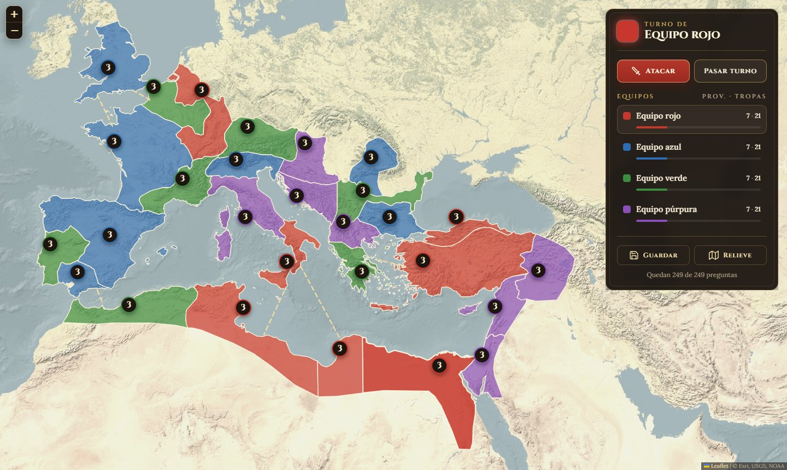
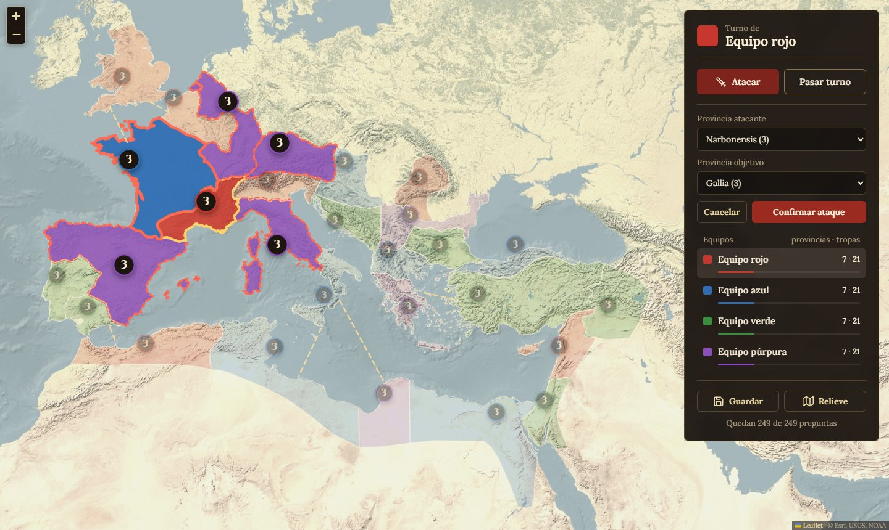
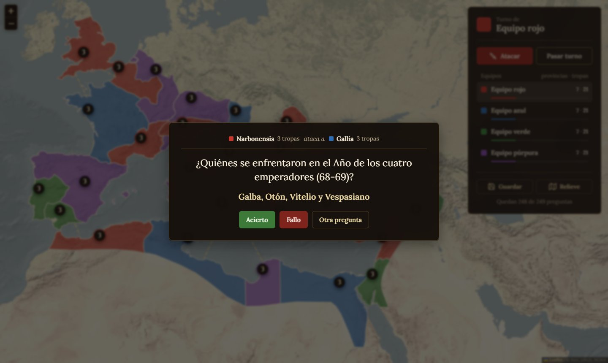
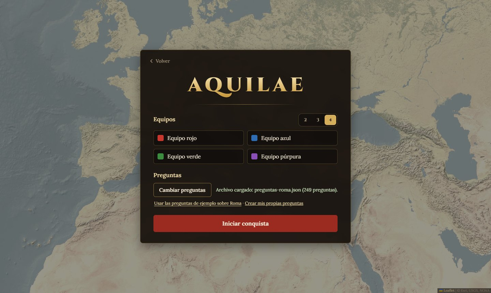
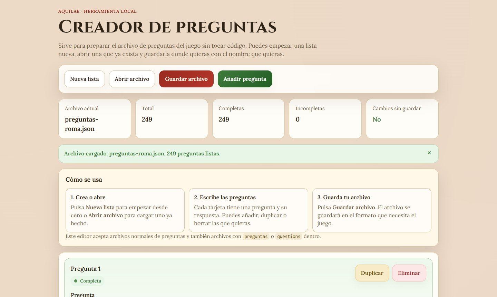

# AQUILAE · Juego de preguntas del Imperio Romano para el aula

**Probado en el aula en 3 centros educativos, con alumnado de Educación Secundaria y de Bachillerato.** Juego de estrategia por turnos en el navegador para repasar Historia de Roma y Latín jugando. La clase se divide en equipos que se reparten las provincias del Imperio Romano sobre un mapa real. Para conquistar una provincia enemiga, el equipo tiene que responder bien una pregunta de la materia.

**[▶ Jugar](https://gonzalocolina.github.io/Aquilae/)** (pulsa «Usar las preguntas de ejemplo» para probarlo al momento) · **[Creador de preguntas](https://gonzalocolina.github.io/Aquilae/editor/)**



## Contexto

- Diseñado dentro del **Proyecto de Investigación Docente *PhilHum Games***, para un **Trabajo Fin de Máster** del Máster en Educación.
- El profesorado no necesita saber programar: prepara sus preguntas con el editor incluido, las guarda en un archivo y las carga al empezar la partida. El mismo juego vale para cualquier tema o asignatura.

## Cómo se juega

1. Se eligen de 2 a 4 equipos y se cargan las preguntas (un archivo propio o el banco de ejemplo).
2. Las provincias se reparten al azar y cada una empieza con 3 tropas.
3. En su turno, un equipo pulsa **Atacar** y elige una de sus provincias con al menos 2 tropas y la provincia enemiga vecina que quiere conquistar, por tierra o por ruta marítima. Se puede hacer pulsando en el mapa, que resalta los objetivos posibles, o con los desplegables del panel lateral. Las dos vías están sincronizadas.
4. Sale una pregunta. El docente muestra la respuesta y marca si ha sido un **acierto** (se conquista la provincia) o un **fallo** (la provincia atacante se queda con 1 tropa).
5. Gana quien conquiste todo el Imperio. Si se acaban las preguntas, gana el equipo con más tropas.

El docente puede ajustar las tropas de cualquier provincia pulsándola, y la partida se puede guardar en un archivo para retomarla en la siguiente clase.

| Elegir el ataque (mapa o panel) | Pregunta y respuesta |
|---|---|
|  |  |



### Creador de preguntas

Herramienta aparte para crear, editar, duplicar y validar bancos de preguntas, sin tocar código ni JSON a mano.



## Detalles técnicos

- **HTML, CSS y JavaScript sin framework ni paso de compilación.** Cada herramienta es un único archivo HTML que funciona abriéndolo en el navegador, así que es fácil de usar en los ordenadores de un centro educativo.
- **Mapa con [Leaflet](https://leafletjs.com/)**, a partir de los datos GeoJSON de las provincias romanas de [klokantech/roman-empire](https://github.com/klokantech/roman-empire).
- **Vecindad entre provincias calculada con [Turf.js](https://turfjs.org/)** (`booleanIntersects`). Además hay conexiones marítimas, que se dibujan como rutas curvas y se comprueba que no atraviesen tierra.
- **Partidas guardadas y bancos de preguntas en JSON**, validados al cargarlos (formato, campos obligatorios, IDs repetidos). No hace falta servidor ni base de datos.
- **Interfaz adaptable** a proyector, ordenador y móvil, con el panel de juego abajo en pantallas estrechas.
- **Despliegue automático en GitHub Pages** con GitHub Actions: el juego se sirve en `/`, el editor en `/editor/` y los bancos de ejemplo en `/ejemplos/`.

### Formato de las preguntas

```json
[
  { "id": "roma-001", "pregunta": "¿Qué héroe es considerado el progenitor del pueblo romano?", "respuesta": "Eneas" },
  { "id": "roma-002", "pregunta": "¿De qué ciudad provenía Eneas?", "respuesta": "De Troya" }
]
```

El campo `id` es opcional. En [`ejemplos/preguntas-roma.json`](ejemplos/preguntas-roma.json) hay un banco de 249 preguntas sobre Roma, desde los orígenes hasta el Imperio.

## Estructura

```
Aquilae.html            Juego (carga las preguntas desde un archivo JSON)
editor-preguntas.html   Creador de preguntas
Aquilae Latín.html      Primera versión, con las preguntas integradas en el código
ejemplos/               Bancos de preguntas listos para usar
docs/capturas/          Capturas del README
```

## Autoría

- **Desarrollo:** Gonzalo Colina ([@gonzalocolina](https://github.com/gonzalocolina))
- **Diseño didáctico, preguntas y validación en el aula:** Juan Pérez González ([@Juaan51](https://github.com/Juaan51)), Proyecto de Investigación Docente *PhilHum Games*
